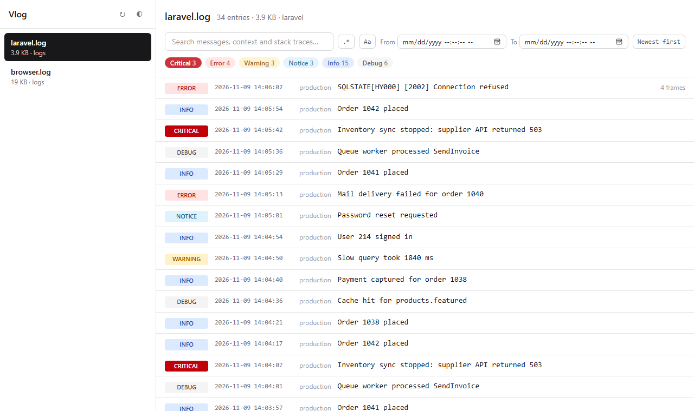

# Vlog

A fast, secure log viewer for Laravel. Browse, filter and search your application's log files in the browser, including files that are gigabytes in size.



## Features

- **Handles large files.** Vlog indexes each log file once, then opens any page instantly. Only new lines are read as the file grows, and memory use stays low regardless of file size.
- **Understands your logs.** Vlog reads Laravel (Monolog), Monolog JSON, and CodeIgniter 3 and 4 log formats, and detects the format automatically. Multi-line entries stay together, and stack traces are split into frames.
- **Filters and search.** Vlog filters by level and date range, and searches messages, context and stack traces as plain text or as a regular expression.
- **Hides secrets.** Passwords, tokens, API keys and other secrets are replaced with `[redacted]` before they reach the browser.
- **Doesn't depend on your frontend.** The interface is built in, so it doesn't use your application's Vite, React, Vue or Tailwind setup.
- **Light and dark themes**, and URLs you can share that keep the selected file and filters.

## Requirements

| | Version |
|---|---|
| PHP | 8.2 or later, 64-bit |
| Laravel | 12 or 13 |

## Installation

Install the package with Composer:

```bash
composer require rss/vlog
```

Then visit `/vlog` in your application. Laravel registers Vlog automatically.

## Access in production

By default, Vlog is only available when your application's environment is `local`. To allow access in other environments, define a `viewVlog` gate in a service provider, such as `App\Providers\AppServiceProvider`:

```php
use App\Models\User;
use Illuminate\Support\Facades\Gate;

public function boot(): void
{
    Gate::define('viewVlog', function (User $user) {
        return in_array($user->email, [
            'admin@example.com',
        ]);
    });
}
```

When the gate's closure requires a user, as in this example, guests are always denied.

> [!WARNING]
> Log files often contain personal data and secrets. Always define a `viewVlog` gate before deploying Vlog. Without one, Vlog only checks that the environment is `local`, so a server that is mistakenly set to `local` would let anyone view your logs.

## Configuration

To change Vlog's settings, publish its configuration file:

```bash
php artisan vendor:publish --tag=vlog-config
```

This creates `config/vlog.php` in your application, with these options:

| Option | Default | Description |
|---|---|---|
| `enabled` | `true` | Set to `false` to remove every Vlog route. Also set by `VLOG_ENABLED`. |
| `path` | `vlog` | The URL path Vlog is served at. Also set by `VLOG_PATH`. |
| `domain` | `null` | An optional domain to serve Vlog from. Also set by `VLOG_DOMAIN`. |
| `middleware` | `['web']` | Middleware for Vlog's routes. The `viewVlog` gate is always checked after these. |
| `paths` | `[storage_path('logs')]` | The folders Vlog can read logs from. |
| `patterns` | `['*.log']` | The file name patterns to include. |
| `max_depth` | `3` | How many levels of subfolders to search. |
| `redact` | See [Hiding secrets](#hiding-secrets) | Settings for hiding secrets. |
| `index_path` | `storage_path('framework/vlog')` | Where indexes are stored. |
| `time_limit` | `2.0` | The most seconds one request spends indexing or searching. |
| `max_entry_bytes` | `1048576` | Entries larger than this are shortened when displayed. |

> [!IMPORTANT]
> Vlog can show any file in the `paths` folders that matches `patterns`. Only list folders that contain logs, never broad folders such as your application's root folder.

To read CodeIgniter 3 logs, which use a `.php` extension, add their pattern:

```php
'patterns' => ['*.log', 'log-*.php'],
```

## Hiding secrets

Before an entry is sent to the browser, Vlog hides:

- **Context values** under keys that look secret, such as `password`, `token`, `api_key`, `secret`, `authorization`, `cookie` and `credit_card`, at any depth.
- **Secrets written in text**, such as `password=...`, `"api_key": "..."`, bearer and basic tokens, JSON Web Tokens, passwords in URLs, private keys, and AWS, GitHub, Stripe and Slack keys.

To hide more, add context keys or regular expressions with delimiters:

```php
'redact' => [
    'enabled' => true,
    'keys' => ['iban', 'national_id'],
    'patterns' => ['/ACME-\d{4}-\d{4}/'],
],
```

Hiding protects secrets from being shown on screen, such as during screen sharing. It has two limits:

- It recognises common formats only, so it can miss secrets. Logs still shouldn't contain them.
- Search runs on the original text, so anyone who can access Vlog can still confirm whether a log contains a specific value.

To turn hiding off, set `VLOG_REDACT=false`.

## Large files and indexes

The first time a log file is opened, Vlog builds an index of where each entry starts. The index is stored in `index_path` and is about 16 bytes per entry. Each later request only reads the lines added since the last one.

For very large files, indexing and searching are limited by `time_limit` so a request never runs for too long. Vlog shows its indexing progress and continues on the next request, and a search that reaches the limit offers to continue.

Indexes are rebuilt automatically when a log file is rotated or replaced. Indexes of deleted log files are removed automatically, and you can delete the `index_path` folder at any time.

## Content Security Policy

The interface is a single page with an inline script and inline styles. If your application uses a strict Content Security Policy with Laravel's `Vite::useCspNonce()`, Vlog uses the same nonce.

## Security

Vlog only accepts `GET` requests and never changes your log files. Files are requested by an ID, not by a path, so only files that Vlog itself finds in your configured folders can be read. Server paths aren't sent to the browser. Responses are never cached, and the page can't be embedded in other sites.

To report a security vulnerability, please contact the maintainer privately instead of opening a public issue.

## Contributing

The PHP code is in `src`, and the interface source is in `resources/ui`. The built interface is committed to `dist`, so installing Vlog doesn't need Node.

```bash
composer install
composer test        # PHP tests
composer analyse     # PHPStan

npm install
npm test             # Interface tests
npm run typecheck
npm run build        # Rebuild dist after changing resources/ui
```

## License

Vlog is open-source software licensed under the [MIT license](LICENSE).
